<p align="center">
  
</p>

# zmk-config-nickey44a (Dual TrackPoint / `lpps` ブランチ)

分割40%ワイヤレス自作キーボード **「Nickey44A」** に、左右デュアル構成の低消費電力ポインティングスティック（LPPS）を組み込んだ ZMK Firmware 設定（`lpps` ブランチ）です。

詳細なドライバ設定・ジッター対策パラメータの内部仕様は [zmk-driver-lpps/README.md](zmk-driver-lpps/README.md) を参照してください。

---

## デュアル TrackPoint 構成と動作仕様

| 側 | 接続役割 | 既定モード | 主な挙動 |
| :--- | :--- | :--- | :--- |
| **右 TrackPoint** | セントラル（USB / ホスト BLE） | マウス移動（`MOUSE_MOVE`） | カーソル移動（速度 `1/2`）。動かすと自動クリック層（Layer 4）が即起動し、Layer 2 押下中は縦スクロールに切り替わる |
| **左 TrackPoint** | ペリフェラル（BLE Split 経由） | スクロール（`MOUSE_SCRL`） | 縦・横スクロール専用（`1/64` 分周・主軸ロック・逆転時および無操作 500ms で端数クリア）。操作時は右と同様に自動クリック層（Layer 4）も即起動する |

### 自動クリックレイヤー（Layer 4）と誤操作防止
- 右または左の TrackPoint を操作すると **Layer 4（TrackPoint レイヤー）** が自動で有効になり、両手親指の 6 キーが左・中・右クリックとして機能します（有効中は左右の赤 LED が点灯、無操作 400ms で自動解除）。
- 親指 6 キー以外の通常キーを押した瞬間に Layer 4 は即時解除され、通常の文字入力へ戻ります。
- 通常キーの打鍵中および打鍵後 `150ms` 間はポインタ入力と Layer 4 起動をロックアウトするため、タイピング振動による誤動作を防ぎます（Shift / Ctrl 等の修飾キー単体押しやマウスクリック中はロックアウトされません）。

---

## TrackPoint 操作ショートカット・LED 表示一覧

デフォルト層で右手親指の **`BACKSPACE` を長押し** している間が **Layer 5** です。設定変更した値（ON/OFF 状態および左右のフィルタ閾値 `N`）はセントラル側のフラッシュメモリに自動保存されます。

| ショートカット | 対象 | 動作内容 | LED 表示（左右同期） |
| :--- | :--- | :--- | :--- |
| **Layer 5 + `@`** | 左 TrackPoint | 有効（ON）/ 無効（OFF）をトグル切り替え | **青**点滅 = ON / **赤**点滅 = OFF |
| **Layer 5 + `W`** | 左 TrackPoint | ジッターフィルタ閾値 `N` を **+1**（鈍感化・ノイズ抑制） | **赤**点滅（約 0.45 秒） |
| **Layer 5 + `S`** | 左 TrackPoint | ジッターフィルタ閾値 `N` を **-1**（高感度化） | **青**点滅（約 0.45 秒） |
| **Layer 5 + `P`** | 右 TrackPoint | ジッターフィルタ閾値 `N` を **+1**（鈍感化・ノイズ抑制） | **赤**点滅（約 0.45 秒） |
| **Layer 5 + `;`** | 右 TrackPoint | ジッターフィルタ閾値 `N` を **-1**（高感度化） | **青**点滅（約 0.45 秒） |
| **Layer 3 / 5 + `X`** | 左 TrackPoint | ゼロ点の手動再キャリブレーション（`&ps_calib`） | なし（※スティックに触れずに押す） |
| **Layer 3 / 5 + `=`** | 右 TrackPoint | ゼロ点の手動再キャリブレーション（`&ps_calib`） | なし（※スティックに触れずに押す） |

- `N` 値の初期値は **右 = `8`**、**左 = `10`**（設定可能範囲：`1〜127`）です。
- 左 TrackPoint を OFF にした場合、セントラル（右側）の入り口で入力を破棄するため、左キーボードの電源を切って入れ直した後も OFF 状態が維持されます。

---

## 現在のキーマップ



---

## キーマップの変更方法

### Keymap Editor を使う場合
Web GUI ツール **[Keymap Editor](https://nickcoutsos.github.io/keymap-editor/)** で編集する場合は、対象ブランチに必ず **`lpps`** を選択してください。

- キーマップ下部の 2 つの仮想キー（`LTP` / `RTP`）に `&tpc MOUSE_SCRL` または `&tpc MOUSE_MOVE` を割り当てることで、左右の移動／スクロール役割を切り替えられます（カスタム behavior 定義は `config/keymap-editor-behaviors-tpc.json` に収録）。
- 初回設定手順の詳細は [キーマップの変更方法](https://nixiy.github.io/nickey-docs/guides/keymap/) を参照してください。

### コードを直接編集する場合
`config/nickey44a.keymap` を編集して `lpps` ブランチへ Commit / Push すると、GitHub Actions がファームウェアのビルドとキーマップ SVG の再生成を自動で行います。

---

## ファームウェアの取得・書き込みとトラブル対処

### 1. ビルド成果物（ZIP）のダウンロード
`lpps` ブランチへ Push すると GitHub Actions（`.github/workflows/build.yml`）が実行され、各実行ページ下部の **Artifacts** 欄に以下の命名規則で ZIP が生成されます（ダウンロードには GitHub へのログインが必要です）。

```text
Nikkey44A_Farm_No<ビルド番号>_<コミット件名>.zip
```

展開すると以下の 3 ファイルが含まれます。

| ファイル名 | 書き込む側 | 用途 |
| :--- | :--- | :--- |
| `nickey44a_l.uf2` | 左手側 | 左キーボード用ファームウェア |
| `nickey44a_r.uf2` | 右手側 | 右キーボード用ファームウェア（ZMK Studio 対応） |
| `settings_reset.uf2` | 左右共通 | ペアリング情報・保存済み設定の初期化用 |

基本的な書き込み手順は [Firmwareの書き込み方法](https://nixiy.github.io/nickey-docs/guides/firmware/) および [Nickey44A ビルドガイド](https://nixiy.github.io/nickey-docs/nickey44a/) を参照してください。

### 2. トラブルシューティング
- **片側の TrackPoint が全く反応しなくなった場合**
  1. **完全電源リセット**：特に右手側は「電池」と「USB」の 2 系統から給電されるため、**電源スイッチを OFF にしたうえで USB ケーブルも抜き、5 秒ほど待ってから再接続**してセンサーチップを再起動してください。
  2. **保存された設定の確認**：左が動かない場合は `Layer 5 + @` を押して青点滅（ON）になるか確認してください。`N` 値が大きすぎる場合は `Layer 5 + S`（左）/ `Layer 5 + ;`（右）を複数回押して閾値を下げてください。
- **ドリフト（手を離しても動く現象）が出る場合**
  スティックに一切触れない状態で `Layer 5 + X`（左）または `Layer 5 + =`（右）を押してゼロ点再キャリブレーションを実行してください。
- **左右間の接続やキー入力がおかしい場合**
  左右両方に一度 `settings_reset.uf2` を書き込んでから、再度 `nickey44a_l.uf2` と `nickey44a_r.uf2` を書き込んでペアリングし直してください。

---

## Nickey44A ハードウェア基本情報

- 44キーのオーソリニア配列を採用した左右分割ワイヤレスキーボード（Choc v2 対応・単4電池駆動）
- [Nickey44A キット版 (BOOTH)](https://potamega.booth.pm/items/8744351) / [Nickey44A 完成品 (BOOTH)](https://potamega.booth.pm/items/8744204)
- [Nickey44A ビルドガイド](https://nixiy.github.io/nickey-docs/nickey44a/)

---

## ライセンス

This repository is licensed under the MIT License - see the [LICENSE](LICENSE) file for details.  
同梱モジュール `zmk-driver-lpps` は GPL-2.0-or-later（一部追加ファイルは MIT）に基づきます。詳細は `zmk-driver-lpps/LICENSE` を参照してください。

### 第三者ライセンス
Nickey44A の昇圧回路は、cormoran 氏が [DYA Dash の回路設計解説](https://note.com/cormoran/n/n1e45fe7471d8) で紹介している各種保護機能付き昇圧回路を参考にしています（MIT License）。

- Copyright (c) 2025 cormoran
- ライセンス全文: [THIRD_PARTY_NOTICES.md](THIRD_PARTY_NOTICES.md)
